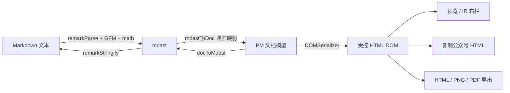

# editor-plus 架构与实现原理

> 一句话概括：以 **ProseMirror 文档模型为唯一数据源**、**remark/mdast 为序列化中间表示**的现代 Markdown 编辑器。
> 预览、复制、导出共用同一条渲染管线，从根上保证「所见即所得视图 / 源码视图 / IR 分屏 / 剪贴板 / 导出文件」输出一致。

## 目录

1. [项目定位与设计理念](#1-项目定位与设计理念)
2. [技术选型](#2-技术选型)
3. [分层架构总览](#3-分层架构总览)
4. [核心数据流与 round-trip 不动点](#4-核心数据流与-round-trip-不动点)
5. [Schema 设计关键决策](#5-schema-设计关键决策)
6. [解析与序列化](#6-解析与序列化)
7. [editor-core：编辑核心](#7-editor-core编辑核心)
8. [三种编辑模式与切换流程](#8-三种编辑模式与切换流程)
9. [IR 分屏与双向滚动同步](#9-ir-分屏与双向滚动同步)
10. [渲染与导出管线](#10-渲染与导出管线)
11. [安全：受控 HTML 与白名单净化](#11-安全受控-html-与白名单净化)
12. [大纲与字数统计](#12-大纲与字数统计)
13. [Vue 组件层](#13-vue-组件层)
14. [性能策略](#14-性能策略)
15. [构建体系与质量保障](#15-构建体系与质量保障)

---

## 1. 项目定位与设计理念

### 1.1 传统方案的问题

主流 Markdown 编辑器（Vditor、Toast UI Editor 等）大多以 **contenteditable DOM 为数据源**：编辑过程直接操作 DOM，序列化靠遍历 DOM + 正则启发式反推 Markdown。该架构有四个顽疾：

| 问题 | 根因 |
| --- | --- |
| 格式丢失 / 漂移 | DOM 携带的信息（空白、属性）比 Markdown 富，来回转换无稳定性保证 |
| 表格单元格富文本受限 | 序列化反推只能处理有限嵌套 |
| 「复制/导出」与「预览」不一致 | 各功能各自实现一条渲染路径 |
| 复杂结构难以扩展 | 没有 schema 约束，一切靠约定 |

### 1.2 editor-plus 的答案

- **ProseMirror 文档模型是唯一数据源**。所有编辑操作发生在受 schema 约束的结构化文档上，DOM 只是文档的投影。
- **remark/mdast 作为序列化中间表示**。mdast 是业界标准的 Markdown AST（unified 生态），序列化 = 文档模型 → mdast → `remark-stringify`，解析反向同理，不写一行正则。
- **三种编辑外壳，一份内容**。wysiwyg（ProseMirror）、source / ir（CodeMirror 6）都是「同一份 Markdown 的不同编辑界面」；模式切换 = 序列化当前内容 → 全量重建目标视图。
- **单一渲染管线**。`buildPreviewRoot` 同时服务预览面板、公众号复制、HTML/PNG/PDF 导出——一处实现，处处一致。

```
                ┌────────── 编辑 ──────────┐        ┌────────── 输出 ──────────┐
   Markdown ⇄  文档模型(PM Doc)  ⇄  mdast  ⇄  Markdown  ⇄  HTML（预览=复制=导出）
                wysiwyg 视图直接编辑        序列化反序列化      单一管线 buildPreviewRoot
```

---

## 2. 技术选型

| 领域 | 选型 | 说明 |
| --- | --- | --- |
| 文档模型 / wysiwyg | prosemirror-model / state / view / transform / commands / keymap / inputrules / history / dropcursor / gapcursor / schema-list | 结构化编辑的工业标准 |
| 源码编辑 | CodeMirror 6（`codemirror` + `@codemirror/lang-markdown` + `@codemirror/language-data`） | 代码块内嵌语言高亮、行折叠（lineWrapping） |
| Markdown AST | `unified` + `remark-parse` + `remark-gfm` + `remark-math` + `remark-stringify` | 解析/序列化双向，GFM + 数学公式 |
| UI 层 | Vue 3.5（`<script setup>`） + Vite 6 | 组件仅作薄适配，核心逻辑无框架依赖 |
| 类型检查 | TypeScript 5.8（`tsc --noEmit`） | 源码为 JS + JSDoc 类型，不参与编译产物 |
| 代码高亮 | highlight.js（core + 按语言懒加载） | 避免 580KB+ 全量打包 |
| 数学渲染 | KaTeX 0.18 | 动态 import 独立 chunk |
| 图表 | mermaid / echarts / flowchart.js / @viz-js/viz / abcjs / markmap / wavedrom / smiles-drawer（plantuml 走官方服务端） | ` ```lang ` 围栏代码块扩展，统一注册（charts.ts）；栅格化为 2x 白底 PNG（兼容微信），各图表库动态 import 独立 chunk |
| 导出 | html2canvas + jsPDF 4 | 均动态 import（合计 ~550KB，不占首屏） |

---

## 3. 分层架构总览

### 3.1 目录结构

```
editor-plus/
├─ index.html                     # 演示页入口
├─ vite.config.js                 # 端口 5180 / manualChunks 拆包
└─ src/
   ├─ main.js                     # 引入 PM 基础 CSS + editor-plus.css
   ├─ App.vue                     # 演示宿主：复制/导出/round-trip 徽标/大纲统计开关
   ├─ markdown-core/              # ① 数据层：schema + 双向转换（无 DOM 依赖）
   │  ├─ schema.ts                #    editorPlusSchema（节点/标记全集）
   │  ├─ parser.ts                #    Markdown → mdast → PM Doc
   │  ├─ serializer.ts            #    PM Doc → mdast → Markdown
   │  └─ index.ts                 #    门面导出
   ├─ editor-core/                # ② 编辑核心（框架无关门面）
   │  ├─ core.ts                  #    NextEditor：模式/构建/事件/滚动
   │  ├─ commands.ts              #    CommandRegistry（命令唯一出口）
   │  ├─ keymap.ts                #    快捷键 → registry.run
   │  ├─ inputrules.ts            #    输入规则（# 空格→标题等）
   │  ├─ outline.ts               #    大纲提取（Doc 版 / 纯文本版）
   │  ├─ stat.ts                  #    字数统计（CJK 逐字 + 西文分词）
   │  └─ index.ts
   ├─ editor-pm/view.ts           # ③a wysiwyg 视图：ProseMirror 组装
   ├─ editor-cm/view.ts           # ③b source/ir 源码视图：CodeMirror 组装
   ├─ pipeline/                   # ④ 输出管线（预览=复制=导出）
   │  ├─ preview.ts               #    buildPreviewRoot：Doc → 净化 HTML DOM
   │  ├─ sanitize.ts              #    白名单净化（受控 HTML）
   │  ├─ wechat.ts                #    公众号适配（全内联样式）
   │  ├─ social.ts                #    复制公众号 HTML / 导出独立 HTML
   │  └─ export.ts                #    PNG / PDF 导出
   ├─ renderers/                  # ⑤ 渲染扩展点
   │  ├─ registry.ts              #    codeRenderer / transform 注册表
   │  ├─ highlight.ts             #    hljs 懒加载
   │  ├─ katex.ts                 #    KaTeX 懒加载
   │  ├─ rasterize.ts             #    共享栅格化：离屏容器 + SVG → 2x 白底 PNG
   │  ├─ util.ts                  #    looseJsonParse（容忍函数/尾逗号）
   │  ├─ mermaid.ts               #    mermaid → PNG 栅格化
   │  ├─ echarts.ts               #    echarts 5 SSR（无头 SVG）→ PNG
   │  ├─ mindmap.ts               #    echarts tree 数据 → PNG
   │  ├─ flowchart.ts             #    flowchart.js → PNG
   │  ├─ graphviz.ts              #    viz-js（wasm）→ PNG（注册 dot 别名）
   │  ├─ plantuml.ts              #    plantuml-encoder → 服务端 SVG 外链
   │  ├─ abc.ts                   #    abcjs 乐谱 → PNG
   │  ├─ markmap.ts               #    markmap 思维导图 → PNG（污染回退内联 SVG）
   │  ├─ wavedrom.ts              #    wavedrom 时序图 → PNG
   │  ├─ smiles.ts                #    smiles-drawer 化学结构 → PNG
   │  └─ charts.ts                #    side-effect 统一注册全部图表渲染器
   ├─ components/                 # ⑥ Vue 薄适配层
   │  ├─ EditorPlus.vue           #    v-model 接线 NextEditor
   │  ├─ Toolbar.vue              #    配置驱动工具栏
   │  ├─ OutlinePanel.vue         #    大纲面板
   │  └─ PreviewPane.vue          #    预览面板（200ms 防抖）
   ├─ toolbar/config.ts           #    工具栏按钮配置（lucide 风格 SVG）
   └─ styles/editor-plus.css      #    全部样式（含导出内嵌复用）
```

### 3.2 分层依赖关系

依赖方向严格自上而下，**下层不感知上层**；核心三层（①②③）完全不依赖 Vue：

```
┌───────────────────────── Vue 组件层（⑥）──────────────────────────┐
│  App.vue   EditorPlus.vue   Toolbar.vue   OutlinePanel.vue        │
│                            PreviewPane.vue                        │
└───────────────┬──────────────────────────────────▲────────────────┘
                │ new NextEditor / v-model          │ renderMarkdownToHTML
┌───────────────▼──────────────────────────────────┴────────────────┐
│                editor-core（②）— NextEditor 门面                    │
│   core.ts │ commands.ts │ keymap.ts │ inputrules.ts │ outline/stat │
└──────────┬───────────────────────────────────────┬─────────────────┘
           │ wysiwyg                                │ source / ir
┌──────────▼───────────┐              ┌─────────────▼────────────┐
│  editor-pm（③a）      │              │  editor-cm（③b）          │
│  ProseMirror 视图     │              │  CodeMirror 6 视图        │
└──────────┬───────────┘              └─────────────┬────────────┘
           │ EditorState.doc                         │ state.doc (Text)
┌──────────▼─────────────────────────────────────────▼─────────────┐
│        markdown-core（①）— 文档模型 ⇄ mdast ⇄ Markdown            │
│           schema.ts │ parser.ts │ serializer.ts                   │
└──────────▲────────────────────────────────────────────────────────┘
           │ markdownToDoc / DOMSerializer
┌──────────┴─────────────────────────────────────────────────────────┐
│  pipeline（④）preview / sanitize / wechat / social / export        │
│  renderers（⑤）registry / highlight / katex / mermaid              │
└─────────────────────────────────────────────────────────────────────┘
```

要点：

- **wysiwyg 模式**下命令（工具栏/快捷键）直接操作 PM Doc；**source / ir 模式**下 CodeMirror 直接编辑 Markdown 文本，命令层停用（registry 的 getter 在非 wysiwyg 模式返回 `null`）。
- **输出管线（④⑤）不依赖任何编辑视图**，只依赖 markdown-core——所以 IR 右侧预览、独立预览面板、复制、导出天然同源。

---

## 4. 核心数据流与 round-trip 不动点

### 4.1 双向数据流



- **入方向**（`markdownToDoc`）：同步 `mdProcessor.parse(md)` 得 mdast，再 `mdastToDoc` 递归转换为 PM 节点。
- **出方向**（`docToMarkdown`）：`docToMdast` **手工构造** mdast（不走 DOM 反推），再 `stringifyProcessor.stringify`。
- **渲染方向**：`DOMSerializer.fromSchema(editorPlusSchema).serializeFragment(doc.content)` 把文档序列化为 DOM 片段——文本节点天然转义，无 XSS 注入面。

### 4.2 round-trip 不动点性质（生死线）

mdast 的信息量大于 PM schema（如 definition、footnoteDefinition 被丢弃），所以 **parser/serializer 不可能严格互逆**。本项目追求的是一个更实用、也更可验证的性质——**不动点**：

```
markdownToDoc(md).toJSON()
  === markdownToDoc(docToMarkdown(markdownToDoc(md))).toJSON()
```

即：**任何内容经过一次「序列化→再解析」后，文档模型不再变化**。这保证了：

- 用户编辑过程中内容永远不会「越改越变形」；
- 模式切换、setMarkdown、复制导出都是幂等的。

`App.vue` 底部徽标实时校验该性质：markdown 变化后 500ms 防抖，再经 `requestIdleCallback`（timeout 1500ms）空闲执行两次解析比对，**移出按键关键路径**。

### 4.3 成对维护约定

不动点性质依赖 parser/serializer 的成对维护，当前约定：

| 约定 | parser（入） | serializer（出） |
| --- | --- | --- |
| 软换行 | `normalizeText`：段落内 `\n` 归一为空格 | 输出单行段落 |
| definition / footnoteDefinition | 丢弃（返回 `[]`） | 不产出 |
| linkReference / imageReference | 降级：linkRef → 内联文本+链接，imageRef → alt 文本 | 不产出 |
| footnoteReference | 忽略 | 不产出 |
| 列表 | — | 恒 `spread: false`（紧凑输出） |
| code mark | 行内代码为 node `inline_code` | mark 包裹时 code **最内层**（`MARK_ORDER` 中 code=4，reverse 后最先包，保证外层是 strong/em 而非代码） |
| heading 层级 | 钳位 1–6 | 按 attrs.level 输出 |
| mark 嵌套顺序 | — | `MARK_ORDER = {link:0, strong:1, em:2, strike:3, code:4}` 排序后 reverse，逐层由内向外包裹（link 最外层） |

修改任何一侧时，必须同步检查另一侧 + 观察底部徽标。

---

## 5. Schema 设计关键决策

`markdown-core/schema.ts` 定义 `editorPlusSchema`，节点与 Markdown 语法一一对应：

| 节点/标记 | 决策 | 原因 |
| --- | --- | --- |
| 表格 | **静态表格**（不引入 prosemirror-tables）；对齐存 `table.align` 属性；首行为 `table_header_cell` | 避免重依赖；单元格内容固定为单 paragraph（仅 inline），保证序列化无损 |
| 任务清单 | `list_item` 增加 `checked: null \| true \| false` 属性；DOM 输出 `data-checked` | checked=null 表示普通列表项，true/false 为任务态；序列化输出 `- [ ]` / `- [x]` |
| 原始 HTML | `html_block`（DOM: `div[data-html-block]`）与 `html_inline`（`span[data-html-inline]`）**原子占位节点**，contenteditable=false，编辑器内显示原文 | 安全边界：编辑器内永不执行/渲染原生 HTML，仅预览管线净化后替换为真实 DOM（见 §11） |
| 数学公式 | `math_block` / `math_inline` 原子节点，携带 TeX 源码；**`marks: ''`** | 与 HTML 同策略（编辑器内保留源码，预览时 KaTeX 渲染）；`marks:''` 使其不可携带任何 mark，防止往返漂移 |
| 纯文本 | `text` **必须显式 `group: 'inline'`** | 缺省时 PM 校验认为文本不属于 inline 组，纯文本文档会被静默回滚 |
| code mark | `excludes: '_'` | 代码内不允许叠加其他标记 |
| link mark | `inclusive: false` | 光标移出链接后继续输入不再延续链接，符合直觉 |

---

## 6. 解析与序列化

### 6.1 parser.ts：Markdown → 文档模型

```js
export const mdProcessor = unified().use(remarkParse).use(remarkGfm).use(remarkMath)

export function markdownToDoc(md, schema = editorPlusSchema) {
  const ast = mdProcessor.parse(md)
  return mdastToDoc(ast, schema)
}
```

`mdastToDoc` 分两层递归：

- **块级 `blockNode`**：paragraph / heading（depth 钳位 1–6）/ blockquote / list（ordered → `order` 属性）/ listItem（checked 属性，空项自动补 paragraph）/ code（`params` 存语言）/ thematicBreak / table（align 属性 + 首行 header_cell）/ html / math；**definition、footnoteDefinition、未知类型 → 返回 `[]` 直接丢弃**（§4.3 约定）。
- **行内 `inlineNode`**：text / break / inlineCode / strong / em / delete / link 递归累积 marks；image / html_inline / math_inline 为原子节点；linkReference / imageReference 按表降级。

### 6.2 serializer.ts：文档模型 → Markdown

```js
export const stringifyProcessor = unified().use(remarkStringify, {
  bullet: '-', rule: '-', fence: '`', emphasis: '_',
  strong: '*', listItemIndent: 'one',
}).use(remarkGfm).use(remarkMath)

export function docToMarkdown(doc) {
  return stringifyProcessor.stringify(docToMdast(doc))
}
```

固定输出风格：`-` 列表符、`*` 加粗、`_` 斜体、三反引号围栏、紧凑列表。行内序列化由 `inlineNodeToMdast` 按 `MARK_ORDER` 排序后 reverse 逐层包裹 mark（见 §4.3），code mark 转为无 children 的 `inlineCode`。

---

## 7. editor-core：编辑核心

### 7.1 NextEditor 门面（core.ts）

框架无关的编辑器门面，Vue 层只是它的薄适配。公开 API：

| API | 行为 |
| --- | --- |
| `getMarkdown()` | wysiwyg → `docToMarkdown(state.doc)`；CM → `state.doc.toString()`；视图未就绪时返回 `_lastMd` 兜底 |
| `getDoc()` | 当前 PM 文档（仅 wysiwyg） |
| `getOutline()` | wysiwyg → `outlineFromDoc(doc)`；其他 → `outlineFromText(text)` |
| `getStats()` | `textStats(getMarkdown())` |
| `scrollToPos(pos)` | 跳转到文档位置（大纲点击），见 §12.3 |
| `setMarkdown(md)` | **全量重建**：`_build(md)` |
| `setMode(mode)` | 序列化 → 换模式 → `_build(md)` → 发 `modeChange` |
| `focus()` / `destroy()` | 焦点 / 销毁（代数自增使在途构建作废） |
| `on(event, cb)` | 订阅事件，返回退订函数 |
| `commands` | CommandRegistry 实例（§7.2） |

**事件系统**（`_listeners`，均支持多订阅者）：

| 事件 | 触发时机 | 消费方 |
| --- | --- | --- |
| `change` | 内容变化（携最新 markdown） | EditorPlus → `update:modelValue` + 刷新大纲/字数 |
| `modeChange` | 模式切换完成 | EditorPlus → `update:mode` + 刷新 |
| `transaction` | 每次 PM dispatch / CM selection+doc 更新 | EditorPlus → `commands.activeIds()` 工具栏高亮 |
| `build` | 异步视图构建就绪 | EditorPlus → 刷新（CM 视图异步建立，必须等此事件） |

### 7.2 CommandRegistry（commands.ts）

**所有编辑命令的唯一出口**：工具栏点击、快捷键、宿主 API 三者共用同一注册表。构造时注入两个 getter（非 wysiwyg 模式返回 `null`，即命令只在 wysiwyg 生效）：

```js
new CommandRegistry(
  () => (this._mode === 'wysiwyg' && this._view ? this._view.state : null),
  () => (this._mode === 'wysiwyg' && this._view ? this._view : null)
)
```

- `withView(cmd)` 适配器：把 PM 原生命令包装为「取当前 state → 用 view.dispatch 落盘」。
- `run(id, ...args)` 返回是否执行了有效编辑；`isActive(id)` / `activeIds()` 供工具栏高亮。
- **toggle 语义命令**：blockquote / bulletList / orderedList 用 `firstSuccess(包裹, 提升)` 链——无列表则包裹，已在列表中则提升一层；`taskListToggle` 沿 `$from` 深度向上找 `list_item`，在 `null → true → false → null` 间循环。
- **异步输入命令**（link / insertImage）：浮层输入是异步的，回调里必须**重新取 state** 构造 transaction（旧 state 已过期）。输入浮层 `askText` 优先 `window.prompt`，受限环境（webview/自动化）自动抛错时降级为自制浮层。
- `insertTable`：空段落直接替换；非空块内对块级 isolating 节点 `replaceSelectionWith` 的 fit 会抛 TypeError，改为插到当前顶层块之后，并把光标移入首个单元格内容位。

### 7.3 快捷键（keymap.ts）与输入规则（inputrules.ts）

- **keymap**：`Mod-b/i/e/k` 等全部转发 `registry.run(id)`，与工具栏共享激活状态。特例：`Tab` 在代码块内插入两空格、在列表内走 `indent`；`Enter` 链式 `splitListItem → baseKeymap.Enter`；未覆盖键回退 `baseKeymap`。
- **inputrules**：
  - 块级用官方模式：`#`~`######` + 空格 → 标题、`>` + 空格 → 引用、``` ```lang ``` → 代码块、`-/+/*` → 无序列表、`1.` → 有序列表（带序号连续性校验）。
  - 自实现 `markInputRule`：正则必须带两个捕获组 `(定界符)(内容)` 且 `$` 锚定末端；转换时**从后往前删除定界符**（位置不失效），对内容 addMark。覆盖 `**粗体**`、`*斜体*`（负向后顾防止 `**粗*` 误触发）、`~~删除~~`、`` `代码` ``。
  - 非对称定界符自实现：`[text](url)` → link mark 文本；`$tex$` → **math_inline 原子节点**（它是节点不是 mark）。
  - 任务清单 `- [ ] `：`findWrapping` 求包装链后，把链中的 `list_item` 替换为带 `checked` 属性的版本再 `tr.wrap`。

---

## 8. 三种编辑模式与切换流程

### 8.1 模式语义

| 模式 | 编辑外壳 | 数据形态 | 典型场景 |
| --- | --- | --- | --- |
| `wysiwyg` | ProseMirror | PM 文档模型 | 富文本化写作，工具栏/快捷键全可用 |
| `source` | CodeMirror 6（单栏） | Markdown 纯文本 | 源码级精细控制 |
| `ir` | CodeMirror 6 + 预览（分屏） | 左 Markdown 文本 / 右 HTML | 即时渲染（Instant Rendering），仿 Typora/Vditor |

### 8.2 构建流程 `_build(markdown)`

`_build` 是唯一视图构建入口（构造器、`setMode`、`setMarkdown` 都走它），**async 全量重建**：

```js
async _build(markdown) {
  const gen = ++this._buildGen          // ① 构建代数 +1
  this._lastMd = markdown
  // ② 确保 .ep-editor 容器存在；销毁旧视图（view.destroy + teardownIrSync）
  if (mode === 'wysiwyg') {
    // ③a 同步：createProseView(this._el, {doc, registry, ...})
    this._emit('build')
  } else {
    // ③b 异步：const { createCodeView } = await import('../editor-cm/view.js')
    if (gen !== this._buildGen) return  // ④ 构建期间模式/内容又变了 → 丢弃
    // source：直接建 CM 视图 + emit('build')
    // ir：建 .ep-ir-src + .ep-ir-preview，绑 onChange→防抖重建预览、双向滚动同步，
    //     _renderIrPreview(markdown, gen)（内部同样做双重代数守卫）
  }
}
```

**`_buildGen` 代数守卫**：CM 视图经动态 import 异步构建，期间可能发生 `destroy()` / `setMode()` / `setMarkdown()`。旧构建完成后必须比对代数，不一致则整体丢弃——这是异步视图不串台的关键。

**模式切换 = 序列化 + 重建**，而非视图互换：

```js
setMode(mode) {
  const md = this.getMarkdown()   // 当前外壳吐出 Markdown
  this._mode = mode
  this._build(md)                 // 目标外壳从头构建
  this._emit('modeChange', mode)
}
```

代价是切换瞬间丢失光标/选区（全量重建），换来的是**实现极简且三模式内容绝对一致**。

### 8.3 两种视图的组装

- **editor-pm/view.ts**：`createProseView(place, opts)` 组装插件栈 `history + buildKeymap(registry) + buildInputRules + dropCursor + gapcursor + placeholderPlugin`。placeholder 插件用 Decoration 实现——空文档判定（`childCount <= 1` 且首节点为空 paragraph）后在位置 1 挂 `span.ep-placeholder` widget（`side: -1`）。`dispatchTransaction`：先 `updateState`，再 `onTransaction()`（工具栏高亮），`docChanged` 时 `onChange()`（序列化上抛）。
- **editor-cm/view.ts**：`createCodeView(place, opts)` 极简组装——`minimalSetup + markdown({base: markdownLanguage, codeLanguages: languages})`（代码块内嵌语言高亮）+ `lineWrapping` + 内联主题 + updateListener（`selectionSet|docChanged → onTransaction`，`docChanged → onChange`）。

### 8.4 CodeMirror chunk 拆分与预取

CM 及其 markdown 语言包（含 language-data 全量语言定义）体积可观，而首屏默认 wysiwyg 用不到。策略：

1. `_build` 中对 CM **动态 import**（独立 chunk，`catch` 后 console.error）；
2. 构造完成后 `_precacheSourceView()`：`requestIdleCallback({timeout: 3000})`（兜底 `setTimeout 1500`）预取该 chunk——用户首次切到 source/ir 时零等待。

---

## 9. IR 分屏与双向滚动同步

IR 模式 DOM 结构：`.ep-editor > .ep-ir-src + .ep-ir-preview`，左栏 CodeMirror 编辑 Markdown，右栏消费与独立预览**完全相同**的 `buildPreviewRoot` 管线。

### 9.1 输入 → 预览联动

```
CM docChanged → onChange
  → _scheduleIrPreview()：150ms 防抖
    → _renderIrPreview(getMarkdown(), gen)
      → await buildPreviewRoot(md)
      → 双重代数守卫（防抖触发时与 await 返回后各查一次 gen）
      → 保存滚动比例 → innerHTML='' + appendChild(root) → 恢复比例（置 _irLock）
```

预览重建前后**保持滚动比例**，避免长文档每次击键预览跳顶。

### 9.2 双向滚动同步

- **方向映射**：两侧各自维护「scrollTop / 最大可滚动距离」比例，一侧滚动时按比例设置另一侧。
- **防回环锁 `_irLock`**：程序化设置对方 scrollTop 期间置锁，抑制对方 scroll 事件再次反向同步；锁在 `requestAnimationFrame` 回调中解除（确保滚动事件已消化）。
- **滚动容器差异**：source 模式 CM 铺满展开、自身无滚动空间（实际滚动容器是外层 `.ep-host`）；ir 模式 `.cm-scroller` 本身即滚动容器。同步与跳转代码统一用「从 `scrollDOM` 向上走查第一个有滚动空间的祖先」兼容两种形态。

---

## 10. 渲染与导出管线

### 10.1 单一管线 buildPreviewRoot（pipeline/preview.ts）

所有 HTML 输出（预览面板、IR 右栏、复制、导出）共用此函数：

```
markdownToDoc(md)                          ← 与编辑器同一文档模型
  → DOMSerializer.serializeFragment        ← 文本天然转义
  → applySanitizedHtml(root)               ← html 占位 → 白名单净化 → 真实 DOM
  → await applyMath(root)                  ← math 占位 → KaTeX HTML
  → 遍历 <pre><code>：
      lang 命中注册表 → 自定义渲染器（图表 lang 命中 → PNG ，整体替换 pre）
      否则 → highlight.js（hljs.highlight，未注册语言 highlightAuto）
  → 依次执行 registerTransform 注册的文档级后处理钩子
  → 返回 div.ep-preview-content（不挂载，供各消费方自行处置）
```

### 10.2 渲染器注册表（renderers/registry.ts）

输出管线的扩展点（借鉴 mdeditor 渲染器 + vditor `previewRender.transform` 钩子）：

- `registerCodeRenderer(lang, fn)`：`lang → (code, lang) => html | Promise<html>`，同名覆盖，返回注销函数；
- `registerTransform(fn)`：对序列化输出 DOM 做后处理（如内联样式化），同样可注销。

图表渲染器在模块加载时（preview.ts 顶部 side-effect import `charts.ts`）统一自动注册，各图表库本体由渲染器内部动态 import（独立 chunk，未使用零成本）：

| lang | 库 | 实现要点 |
| --- | --- | --- |
| mermaid | mermaid 11 | `startOnLoad:false, securityLevel:'strict', htmlLabels:false`——**foreignObject 画到 canvas 会被污染导致 toDataURL 抛错**，故必须关 htmlLabels（v11 中 flowchart-v2 读顶层 `htmlLabels`，只配 `flowchart.htmlLabels` 无效）；`mermaid.render` 失败会把错误 SVG 容器（`#d{id}`）残留在 body 下且不自动清理，`finally` 中手动移除 |
| echarts | echarts 5 | SSR 无头模式：`init(null, null, {renderer:'svg', ssr:true, width, height})` → `setOption({animation:false, ...option})` → `renderToSVGString()` → `dispose()`；option 用 `looseJsonParse` 解析（容忍函数与尾逗号），width/height clamp 200~2000（默认 800×480） |
| mindmap | echarts 5 | JSON / encodeURIComponent(JSON) 双格式数据 → echarts tree 配置（vditor 同款配色），symbol 回调签名是 `(value, params)` 非 `(params)` |
| flowchart | flowchart.js | 离屏 800px 纸张容器 `parse(code).drawSVG(el)`（内部 setSize 自适应） |
| graphviz / dot | @viz-js/viz | wasm 版：`instance()` → `renderSVGElement(dot)` 同步返回未挂载 SVGSVGElement，DOT 非法时抛错 |
| plantuml | plantuml-encoder | 客户端编码 → `plantuml.com/plantuml/svg/~1{编码}` 服务端渲染外链（~1 前缀 = UTF-8），不经本地栅格化 |
| abc | abcjs | 离屏容器 `renderAbc(el, code)` → svg |
| markmap | markmap-lib + view | `Transformer().transform` → `Markmap.create` → `fit()` → 等两帧 rAF（d3 zoom transform 异步写 DOM）；**markmap 硬编码 foreignObject 无开关，栅格化必然污染**，`svgElementToPngImg` 失败时回退输出内联 SVG |
| wavedrom | wavedrom | `renderWaveElement(seq++, source, el, waveSkin, false)`，source 支持 JSON / JS 对象字面量 |
| smiles | smiles-drawer | ESM default 为聚合对象，类挂 `.SmiDrawer`；`new SmiDrawer().draw(code, 'svg', 'light', successCb, errCb)` |

**共享栅格化工具（rasterize.ts）**：

- `withOffscreen(fn)`：离屏容器（`position:fixed; left:-99999px; visibility:hidden`，**不能 display:none，否则 getBoundingClientRect/getBBox 归零**）中执行 async fn，promise settle 后清理。
- `svgToPngImg(svg, opts)`：SVG 字符串 → 补 width/height（缺失时读 viewBox）/xmlns → Image → 2x canvas（白底 `#ffffff`，微信深色模式不透底）→ PNG dataURL ``。
- `svgElementToPngImg(svgEl, opts)`：已挂载 SVG 元素版（clone + 布局尺寸）；**栅格化失败（如 canvas 污染）时 try/catch 回退返回内联 SVG**，保证预览/复制/导出仍可用。

### 10.3 公众号（WeChat）适配（pipeline/wechat.ts)

微信编辑器剥 `<style>` 标签与 class，只保留元素 inline style，因此：

1. `adaptTaskList`：微信不支持 `::before` 与属性选择器，任务清单改为字符前缀 `☑ / ☐`（已完成项加删除线）；
2. 正文包一层 `section` 根容器承载基础排版（微信习惯）；
3. `applyInlineStyles(root, wechatTheme)`：把主题表（选择器 → camelCase 声明）**全量内联**到每个元素。选择器支持 `tag` / `.class` / `tag.class` 及空格分隔的后代选择器（从右往左匹配祖先链）；元素已有 inline style 保留、theme 优先。键序即覆盖优先级（`code` 先于 `pre code`，故代码块内样式生效）。
4. 图表已统一栅格化为 PNG（markmap 因 foreignObject 污染回退内联 SVG），天然兼容微信。

### 10.4 复制与导出

| 能力 | 入口 | 实现 |
| --- | --- | --- |
| 复制公众号 HTML | `social.ts: copySocialHTML` | `buildPreviewRoot + adaptWechat` → 剪贴板写 `text/html`（`ClipboardItem`，失败/非安全上下文降级 `execCommand('copy')`：离屏 contenteditable div + Range 选中） |
| 导出独立 HTML | `social.ts: buildStandaloneHTML` | 同管线输出 + 自包含单文件：default 变体内嵌 `styles/editor-plus.css?inline`（Vite 返回 CSS 字符串），wechat 变体用固定 body 样式 |
| 导出 PNG 长图 | `export.ts: exportPNG` | 离屏挂载（`position:fixed; left:-99999px`，必须进文档样式才参与计算）→ html2canvas 2x 白底 → dataURL 下载 |
| 导出 PDF | `export.ts: exportPDF` | 同上得 canvas → jsPDF A4：按 `页高×pxPerPt` 切片、白底 JPEG(0.92) 逐页 `addImage`，页间无缝；版心宽度 wechat 677px / default 800px |

html2canvas / jsPDF 均为函数内动态 import（合计 ~550KB 独立 chunk），未触发导出不占首屏。

---

## 11. 安全：受控 HTML 与白名单净化

安全模型分两层：

1. **编辑器内**：`html_block` / `html_inline` 是 contenteditable=false 的原子占位，永远只显示原文——**编辑路径零执行风险**。
2. **预览/导出路径**：`sanitize.ts` 白名单净化后才替换为真实 DOM：

| 规则 | 处理 |
| --- | --- |
| 危险标签（script/style/iframe/svg/math/form/input/…） | **连子树整体删除**，不保留内容 |
| 白名单外未知标签 | unwrap——删除标签壳、保留子内容 |
| 注释 | 丢弃 |
| 属性 | 仅 `style/class/title/alt/src/href/colspan/rowspan/open/start/type` |
| href/src 协议 | 仅 `http(s):` / `mailto:` / 相对路径；**含控制字符的 URL 直接拒绝**（控制字符可被解析器忽略从而拼接出 `javascript:` 伪协议）；`data:` 等一律拦截 |

净化失败（解析异常/无有效内容）时保留原文占位，宁可显示代码也不渲染未经验证的 DOM。DOMSerializer 对文本节点天然转义，管线其余部分输出均为受控生成，无额外注入面。

---

## 12. 大纲与字数统计

### 12.1 大纲提取（editor-core/outline.ts）

双实现，按模式自动选择：

- `outlineFromDoc(doc)`（wysiwyg）：`descendants` 遍历过滤 heading → `{ level, text, pos }`，`pos` 为 PM 文档位置。
- `outlineFromText(text)`（source / ir）：逐行正则 `/^(#{1,6})[ \t]+(.+?)[ \t]*#*[ \t]*$/`，配 **围栏守卫**——用 `/^\s*(`{3,}|~{3,})/` 同字符配对跟踪代码块开合，围栏内的 `#` 行不算标题；返回项带行首 offset，供 CM 跳转换算。

### 12.2 字数统计（editor-core/stat.ts）

`textStats(md)` → `{ words, chars }`，中西文混合口径：

- 按 `/\s+/` 切段；段内逐字符累计 `chars`，命中 CJK 正则（汉字 + 假名 + 谚文，`/[\u4e00-\u9fff\u3400-\u4dbf\u3040-\u30ff\uac00-\ud7af]/`）累计 `cjk`；
- `words += cjk + (段内非 CJK 字符数 > 0 ? 1 : 0)`——中文逐字计词、西文按空白串计词。

### 12.3 跳转 scrollToPos(pos)

- **wysiwyg**：`view.domAtPos(pos)` / `nodeDOM(pos)` 取标题 DOM → `scrollIntoView({ behavior:'smooth', block:'start' })`。
- **CM**：`anchor = min(pos, doc.length)` → `dispatch` 设置选区 → `focus()` → `coordsAtPos(anchor)` 取屏幕坐标 → 从 `scrollDOM` **向上走查第一个有滚动空间的祖先**（`scrollHeight > clientHeight + 1`，排除 document.body，兼容 source 模式滚动容器在外层 `.ep-host`、ir 模式滚动容器是 `.cm-scroller` 自身两种形态）→ `scrollTop += coords.top - scroller顶部 - 8`（8px 为行高呼吸边距）。dispatch 后 DOM 同步更新、坐标立即可读，**故意不用 rAF**（后台标签页 rAF 被节流）。
- 几何钳制：末尾标题下方内容不足一屏时 scrollTop 被浏览器钳制在最大值，无法视觉顶部对齐——与原生 `block:'start'`、Vditor 行为一致，非缺陷。

### 12.4 UI 联动

`EditorPlus.vue` 监听 `change / modeChange / build` 三事件刷新大纲与统计（CM 视图异步构建，必须等 `build`），状态栏显示 `N 字 · M 字符`。

---

## 13. Vue 组件层

| 组件 | 职责 |
| --- | --- |
| `EditorPlus.vue` | NextEditor 的**薄适配层**：`v-model` + `v-model:mode` 双向绑定；挂载时 `new NextEditor`，卸载时 `destroy()`；`transaction → activeIds` 工具栏高亮；暴露 `runCmd / focus / getEditor` |
| `Toolbar.vue` | 配置驱动（`toolbar/config.ts`，lucide 风格 24×24 stroke SVG）；按钮 `@mousedown.prevent` 防止编辑器失焦；右侧三模式切换按钮 |
| `OutlinePanel.vue` | 大纲面板：`--lv` CSS 变量层级缩进，点击 emit `jump` → `editor.scrollToPos(item.pos)` |
| `PreviewPane.vue` | 独立预览：200ms 防抖消费 `renderMarkdownToHTML`，支持 `variant: default \| wechat` |
| `App.vue` | 演示宿主：大纲/统计开关、预览变体切换、复制公众号 HTML、导出 HTML/PNG/PDF、round-trip 徽标 |

**v-model 回声抑制**（防止光标跳动）：组件内部维护 `innerValue` 记录编辑器最新输出。外部 `modelValue` 变化时，仅当 `v !== innerValue` 才调 `setMarkdown`——编辑器自己吐出的值回流时不触发重建。模式切换同理。

调试钩子：挂载后 `window.__epEditor = editor`，控制台可直接访问实例。

---

## 14. 性能策略

| 策略 | 位置 | 说明 |
| --- | --- | --- |
| 静态依赖 manualChunks | vite.config.js | 首屏依赖拆 `vendor-prosemirror` / `vendor-vue` / `vendor-remark`（unified/remark/mdast/micromark…），并行加载 + 长缓存；**只归类首屏依赖**，动态依赖保持默认拆分避免被拖进首屏 |
| CodeMirror 动态加载 + 预取 | core.ts | source/ir 才需要的 CM 独立 chunk；挂载后 `requestIdleCallback(timeout 3000)` 预取 |
| highlight.js 按语言懒加载 | renderers/highlight.ts | core + 8 常用语言各自动态 import 注册，避免 580KB+ 全量；必须字符串字面量动态 import（Vite 无法重写指向 node_modules 深路径的模板字符串） |
| KaTeX / 图表库 / html2canvas / jsPDF 动态 import | renderers / export.ts | 全部独立 chunk，未使用零成本（echarts ~1MB、viz-js wasm ~1.35MB、mermaid 系列、flowchart、abcjs、markmap、wavedrom、smiles-drawer 各自懒加载） |
| 输入防抖 | PreviewPane 200ms / IR 150ms | 预览重建 ≠ 每击键 |
| 空闲校验 | App.vue round-trip 徽标 | 500ms 防抖 + `requestIdleCallback(timeout 1500)`，移出按键关键路径 |
| 同步坐标计算 | scrollToPos | dispatch 后 DOM 已同步，不引入 rAF（后台标签页节流） |

---

## 15. 构建体系与质量保障

```bash
npm run dev        # Vite dev server（端口 5180）
npm run build      # 产物构建，target es2020
npm run preview    # 产物预览
npm run typecheck  # tsc --noEmit（JSDoc 类型检查，不产 JS）
```

- **类型策略**：源码为 JS + JSDoc 注释（`@param`/`@type`/`@typedef`），`typecheck` 只做检查不参与编译——保留 JS 灵活性同时获得类型保障。
- **已知构建警告**：产物存在 >500kB chunk 提示（mermaid / katex 等大依赖的动态 chunk），均为按需加载路径，不影响首屏。
- **不变量测试**：round-trip 不动点徽标是常驻的运行时自检（§4.2）；修改 parser / serializer / schema 后必须观察徽标保持「成立」。
- **样式组织**：全部样式集中在 `styles/editor-plus.css`（`.ep-*` 前缀），导出 HTML 时经 `?inline` 复用同一文件，保证导出物与预览样式一致。
